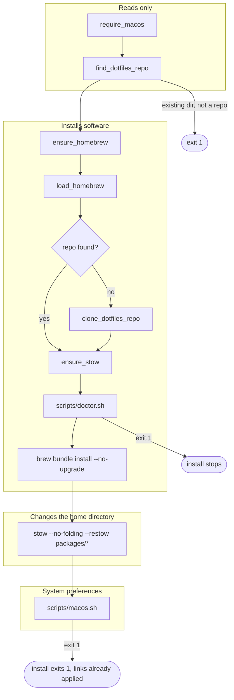
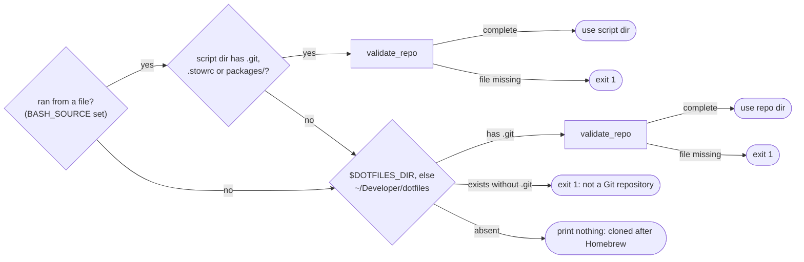

# Install

Run on macOS:

```sh
/bin/bash -c "$(curl -fsSL https://raw.githubusercontent.com/gheorghitahurmuz/dotfiles/HEAD/install.sh)"
```

Or clone and install locally:

```sh
mkdir -p ~/Developer
git clone https://github.com/gheorghitahurmuz/dotfiles.git ~/Developer/dotfiles
cd ~/Developer/dotfiles
bash install.sh
```

To rerun installation from the repository:

```sh
bash install.sh
```

# How it works

The installer runs under `set -e`: the first failing step ends the run. Nothing
changes on the machine before Homebrew, and nothing changes in the home
directory before Stow.



`find_dotfiles_repo` decides where the repository is. Only the "absent" branch
leads to a clone, which waits until Homebrew has provided `git`.


