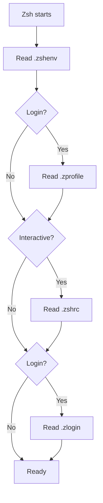

# Zsh

## Startup files

| File | Runs in | Keep here |
| --- | --- | --- |
| `.zshenv` | Every shell | Essential environment variables; no output |
| `.zprofile` | Login shells, before `.zshrc` | Login environment |
| `.zshrc` | Interactive shells | Options, aliases, completions, integrations |
| `.zlogin` | Login shells, after `.zshrc` | Optional session setup |

Login and interactive modes are independent. On macOS, `/etc/zprofile` may
reorder `PATH` before `.zshrc` runs. Scripts cannot rely on `.zshrc` being loaded.

Keep machine-specific additions in `~/.zshrc.local`.

History and the completion dump live under `XDG_STATE_HOME`
and `XDG_CACHE_HOME`, not `$HOME`. Tools that ignore XDG still write
dotfiles to `$HOME`; macOS's `.CFUserTextEncoding` and Finder's `.DS_Store`
cannot be moved. `.zshenv` creates the config directories it exports, because some
tools (Codex) fail when theirs is missing. Moving a tool's directory also needs
its absolute paths rewritten in its own config. LM Studio keeps a pointer file in
`$HOME`, and `~/.agents` is a symlink to `~/.config/agents`. Angular CLI reads
`~/.config/angular/.angular-config.json` if it exists.

`Ctrl-f` accepts the full inline autosuggestion without running the command.

Interactive shells load prompt-related setup. Login shells also load session
setup. A shell can be either, both, or neither; `-i` and `-l` select each mode.



The diagram shows personal startup files. Matching system files run before
their user counterparts. Personal files use `$ZDOTDIR`, or `$HOME` when unset.

## Reload and diagnose

```sh
exec zsh
# Include login startup files:
exec zsh -l
# Measure startup and exit:
/usr/bin/time -p zsh -lic 'exit 0'
```

Restart instead of repeatedly sourcing `.zshrc`. The timing command excludes
some prompt work. To profile functions, temporarily add `zmodload zsh/zprof`
at the start of `.zshrc`, open a shell, and run `zprof`.

Initialize `compinit` once, after setting completion paths. Its normal behavior
already caches completions. Add lazy loading or other optimizations only after
measuring a bottleneck.

If `compinit` warns `insecure directories and files`, a completion directory is
group- or world-writable. Homebrew's `/opt/homebrew/share` is a common cause.
List the offenders with `compaudit`, then remove group write access:

```sh
chmod g-w /opt/homebrew/share
```

Fix the permissions rather than using `compinit -u` or `-C`, which skip the check.

## Reading notes

- [Matthew Clemente: Speeding Up My Shell](https://blog.mattclemente.com/2020/06/26/oh-my-zsh-slow-to-load/)
  — Measure startup first; runtime initializers can cost more than plugins.
  Lazy loading and cached initialization help when those are the bottleneck.
- [Alex T.: Faster and enjoyable ZSH (maybe)](https://htr3n.github.io/2018/07/faster-zsh/)
  — Startup order, profiling, subprocess costs, and completions. Useful for
  understanding macOS path initialization before changing loading order.
- [smallwat3r: Making ZSH fast](https://smallwat3r.com/blog/fast-zsh)
  — Compilation and deferred initialization. Work moved to `precmd` still runs
  before the prompt; it may disappear from a startup-and-exit benchmark.
- [Zsh User's Guide](https://zsh.sourceforge.io/Guide/zshguide02.html)
  — Explains login versus interactive shells and the role of startup files.
- [Zsh introduction: Startup Files](https://zsh.sourceforge.io/Intro/intro_3.html)
  — Quick reference for file order and when each file runs.
- [Zsh manual: Files](https://zsh.sourceforge.io/Doc/Release/Files.html)
  — Full startup and logout sequence, including system files and `$ZDOTDIR`.
- [Zsh manual: Parameters](https://zsh.sourceforge.io/Doc/Release/Parameters.html)
  — Documents the `path` array tied to `PATH`; `typeset -U path` removes duplicates.
- [Zsh manual: Completion initialization](https://zsh.sourceforge.io/Doc/Release/Completion-System.html#Initialization)
  — Explains `compinit`, its dump cache, and security checks. `-C` skips cache
  freshness checks and, with an existing dump, security checks.
- [zsh-bench](https://github.com/romkatv/zsh-bench)
  — Measures first-prompt, first-command, and typing latency beyond simple startup timing.
